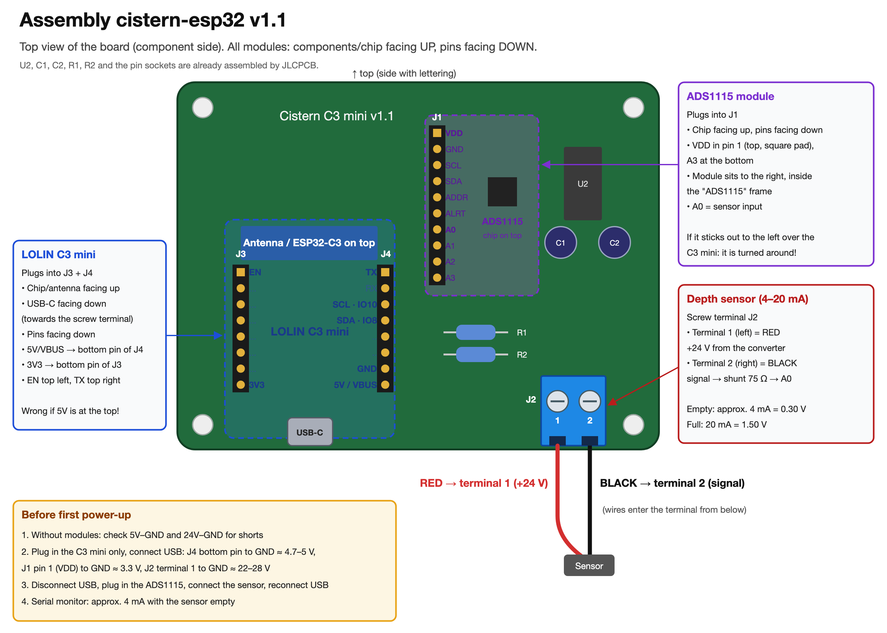

# Cistern Level Monitor

Water level monitoring for cisterns and water tanks: a submersible pressure sensor
(e.g. TL-136, 4–20 mA) sits at the bottom of the tank, a small carrier board with an
ESP32-C3 and an ADS1115 measures the loop current and provides level and history over
WiFi – via web interface and MQTT.

The web interface is available in German and English (browser language, switchable via link). The assembly drawing is available in English and [German](docs/assembly-de.png).

## Contents

| Folder | Content |
|---|---|
| `hardware/cistern-esp32/` | KiCad project of board v1.1 (schematic, layout, custom symbols/footprints) |
| `hardware/cistern-esp32/fab/` | Manufacturing data for JLCPCB: Gerber (ZIP), BOM, CPL |
| `firmware/cistern/` | Arduino firmware (web interface, MQTT, OTA, history) |
| `firmware/ads1115-test/` | Minimal test sketch: reads the loop current and prints it to serial |
| `docs/` | Assembly drawing (English PNG + editable SVG source, German PNG), Home Assistant guide (EN/DE) |

## Hardware

The board is a carrier for off-the-shelf modules plugged into pin sockets:

- **LOLIN C3 mini** (ESP32-C3) in J3/J4
- **ADS1115 module** (16-bit ADC, I²C on GPIO8/GPIO10, address 0x48) in J1
- **Mornsun B0524S-1WR3** (U2): generates the 24 V loop supply from 5 V USB
- **R1/R2**: 2 × 150 Ω in parallel = 75 Ω shunt → 4 mA ≈ 0.30 V, 20 mA ≈ 1.50 V
- **J2**: screw terminal for the sensor (1 = red/+24 V, 2 = black/signal)

Powered via USB-C on the C3 mini. KiCad version: 10.

### Using a Wemos D1 mini (ESP8266)

The sockets J3/J4 follow the D1 mini pinout, so a **Wemos D1 mini** (ESP8266) fits as
well: SCL/SDA are on D1/D2 (GPIO5/GPIO4), 3V3 and 5V are on the same pins.
**The firmware in this repository does not run on the ESP8266** – it uses ESP32-only
libraries. With a D1 mini you need your own firmware, e.g. based on the Make code
linked below or on ESPHome.

Note: the Make code converts the ADC value with a fixed calibration from its own
setup (0.430 V = 0 mm, 1.487 V = 900 mm). On this board the 75 Ω shunt gives
0.30 V at 4 mA and 1.50 V at 20 mA, so adjust the conversion to your sensor range
and calibrate with your own measurements.

### Ordering the board

Upload `fab/cistern-esp32-gerber.zip`, `fab/cistern-esp32-BOM.csv` and
`fab/cistern-esp32-CPL.csv` to JLCPCB. R1/R2 have no LCSC part number – select a
150 Ω resistor (¼ W, axial, 10.16 mm pitch) manually or solder them yourself.
LOLIN C3 mini, ADS1115 module and sensor are sourced separately.

### Before first power-up

1. Without modules: check 5 V–GND and 24 V–GND for shorts.
2. Plug in the C3 mini only, connect USB: J4 bottom pin to GND ≈ 4.7–5 V,
   J1 pin 1 (VDD) ≈ 3.3 V, J2 terminal 1 to GND ≈ 22–28 V.
3. Disconnect USB, plug in the ADS1115 (chip facing up), connect the sensor, reconnect USB.
4. Serial monitor: approx. 4 mA with the sensor empty / not submerged.

## Firmware

Arduino IDE with the ESP32 board package, board "LOLIN C3 Mini". Required libraries:
`Adafruit ADS1X15`, `PubSubClient`.

`firmware/cistern/partitions.csv` replaces the default partition table (2 × 1.56 MB app,
768 KB history, room for 38 months). Switching an existing device to this table needs
one USB flash and erases the history.

The firmware (~1.29 MB) fits the IDE's default 1.25 MiB size check, the default partition
scheme can stay selected – the table from `partitions.csv` is always used.

Features:

- Web interface: `/` shows the level, `/config` the settings
- History: 5-minute values for 38 months, stored raw in flash (no file system)
- MQTT (optional), OTA updates, Telnet log on port 23 –
  see [Home Assistant integration](docs/home-assistant.md) ([Deutsch](docs/home-assistant-de.md))
- Calibration (range, shunt, offset) via `/config`
- Without WiFi an access point `Zisterne-Setup` is started, settings at
  `http://192.168.4.1/config`
- Factory reset: hold the BOOT button for 2 s within the first 5 s after power-up

> **Change the default credentials!** Access point password and web login are
> `zisterne` / `zisterne:zisterne` out of the box. Until the web password is
> changed, `/config` only offers the "Access" tab and OTA updates are disabled.
> OTA is also disabled in access point mode.

## Inspiration and credits

This project was inspired by:

- heise / c't: [Smarte Überwachung: Füllstand von Wassertanks messen und digital abfragen](https://www.heise.de/ratgeber/Smarte-Ueberwachung-Fuellstand-von-Wassertanks-messen-und-digital-abfragen-9867093.html)
- Make code for the heise article (ESP8266/Wemos D1 mini): [MakeMagazinDE/Wassertiefe-messen-und-digital-abfragen](https://github.com/MakeMagazinDE/Wassertiefe-messen-und-digital-abfragen)
- fricklr (Markus Dollinger): [Wasserstand in Zisternen mit HomeAssistant, ESPHome und TL-136 Drucksensor messen](https://fricklr.com/de/wasserstand-in-zisternen-mit-homeassistant-esphome-und-tl-136-drucksensor-messen/)

## AI assistance

This project was developed with the help of [Claude Code](https://claude.com/claude-code)
(Anthropic) – firmware, KiCad design and documentation. All results were reviewed,
built and tested by the author.

## License

- **Hardware** (`hardware/`, `docs/`): [CERN-OHL-S-2.0](LICENSES/CERN-OHL-S-2.0.txt)
- **Firmware** (`firmware/`): [GPL-3.0-or-later](LICENSES/GPL-3.0.txt)

See [LICENSE](LICENSE) for details.

## Disclaimer

Build at your own risk. The circuit uses 5 V and 24 V extra-low voltage – never
connect it to mains voltage. No warranty for function, measurement accuracy or
consequential damage.
