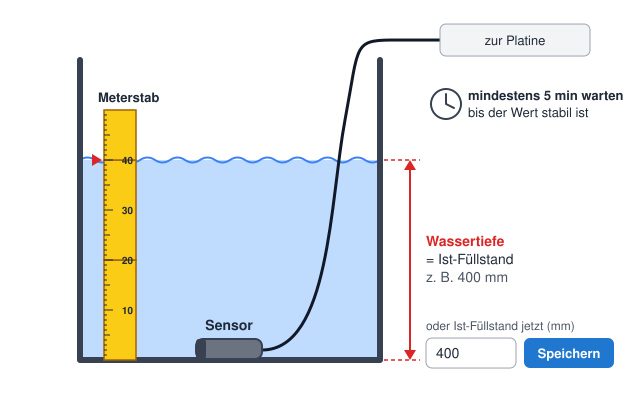

# Sensor kalibrieren

[English version](calibration.md)

Felder und Formel stehen im [Handbuch zur Ersteinrichtung](setup-de.md#6-kalibrierung).

Die Drucksensoren sind nicht alle gleich kalibriert, jeder Sensor weicht etwas ab. Deshalb
jeden Sensor einmal abgleichen und bei Bedarf nachjustieren:

1. **Sensor ins Wasser legen**, am besten gleich an seinen endgültigen Platz am Boden der
   Zisterne.
2. **Wassertiefe messen**, z. B. mit einem Zollstock vom Boden bis zur Wasseroberfläche.
3. **Mindestens 5 Minuten warten.** Der Sensor braucht ein paar Minuten, bis sich der Wert
   fest eingestellt hat. Zur Kontrolle den Reiter **Kalibrierung** ab und zu neu laden: Der
   aktuelle Messwert sollte sich nicht mehr ändern.
4. Die gemessene Tiefe in **oder Ist-Füllstand jetzt** eintragen und **Speichern**. Die
   Zisterne misst sofort und berechnet den Offset so, dass die Anzeige genau diesem Wert
   entspricht. Bei einem Sensorfehler wird der Ist-Wert nicht übernommen, die übrigen
   Felder werden trotzdem gespeichert.
5. **Kontrolle:** Nach ein paar Minuten die Seite neu laden. Der aktuelle Messwert sollte
   jetzt der gemessenen Tiefe entsprechen.

**Kalibrieren außerhalb der Zisterne** (z. B. im Eimer): die Tiefe von der Unterseite des
Sensors bis zur Wasseroberfläche messen. Hängt der Sensor in der Zisterne später über dem
Boden, diesen Abstand danach zum **Offset** addieren.

**Nachjustieren:** Weicht die Anzeige später ab, einfach die Schritte 2–5 wiederholen.

**Abweichung hängt vom Füllstand ab:** Stimmt die Anzeige bei einem Wasserstand, bei einem
anderen aber nicht, passt der Messbereich nicht genau zum Sensor. Dann bei zwei möglichst
unterschiedlichen Wasserständen jeweils die gemessene Tiefe (Ist) und die Anzeige notieren
(jeweils nach 5 Minuten Wartezeit) und den Messbereich korrigieren:

> Messbereich neu = Messbereich alt × (Ist 2 − Ist 1) / (Anzeige 2 − Anzeige 1)

Beispiel: Messbereich 3000, bei 500 mm Ist zeigt sie 520 mm, bei 1500 mm Ist zeigt sie
1480 mm → 3000 × 1000 / 960 = **3125**. Danach den Offset wie oben neu abgleichen.

Die Anzeige wird zusätzlich geglättet (Zeitkonstante 100 s) und Schwankungen von ±1 mm
werden unterdrückt. Ändert sich der Wasserstand, folgt die Anzeige deshalb mit ein paar
Minuten Verzögerung.
