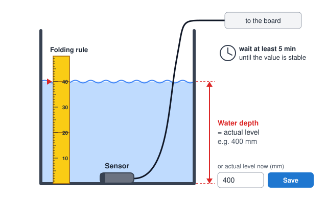

# Calibrating the sensor

[Deutsche Version](calibration-de.md)

Fields and formula are explained in the [setup guide](setup.md#6-calibration).

Pressure sensors are not all calibrated the same, each one deviates a little. So calibrate
every sensor once and readjust it when needed:

1. **Put the sensor in the water**, ideally right at its final place at the bottom of the
   cistern.
2. **Measure the water depth**, e.g. with a folding rule from the bottom to the water
   surface.
3. **Wait at least 5 minutes.** The sensor needs a few minutes until its value has settled.
   To check, reload the **Calibration** tab now and then: the current reading should no
   longer change.
4. Enter the measured depth in **or actual level now** and **Save**. The cistern measures
   right away and calculates the offset so that the display matches exactly this value. On
   a sensor error the actual level is not applied, the other fields are saved anyway.
5. **Check:** reload the page after a few minutes. The current reading should now match the
   measured depth.

**Calibrating outside the cistern** (e.g. in a bucket): measure the depth from the bottom of
the sensor to the water surface. If the sensor later hangs above the cistern floor, add
that distance to the **Offset** afterwards.

**Readjusting:** if the display drifts off later, simply repeat steps 2–5.

**Deviation depends on the level:** if the display is right at one water level but not at
another, the range doesn't match the sensor exactly. Note the measured depth (actual) and
the displayed value at two water levels as different as possible (waiting 5 minutes each
time) and correct the range:

> new range = old range × (actual 2 − actual 1) / (display 2 − display 1)

Example: range 3000, at 500 mm actual it shows 520 mm, at 1500 mm actual it shows 1480 mm →
3000 × 1000 / 960 = **3125**. Then calibrate the offset again as above.

The display is also smoothed (time constant 100 s) and fluctuations of ±1 mm are
suppressed. When the water level changes, the display therefore follows with a delay of a
few minutes.
