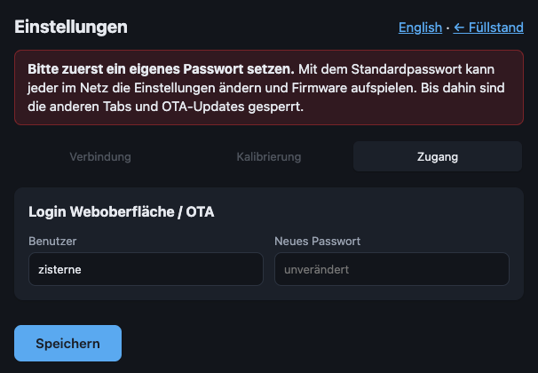
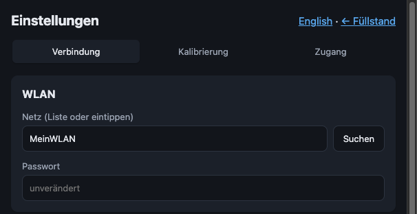
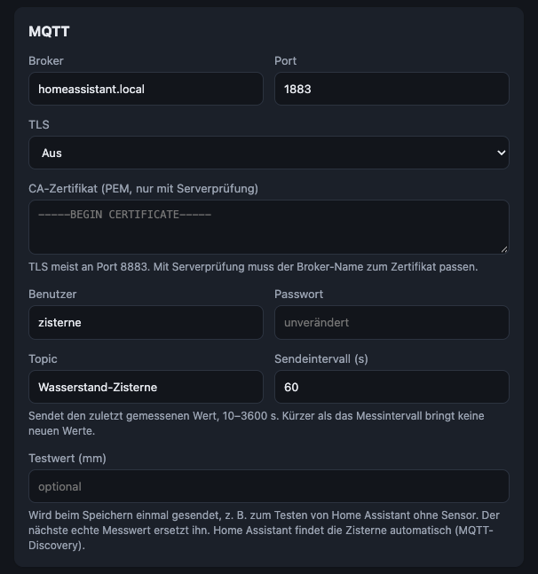
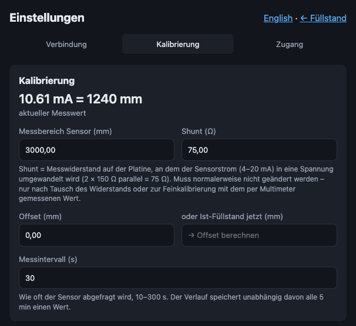
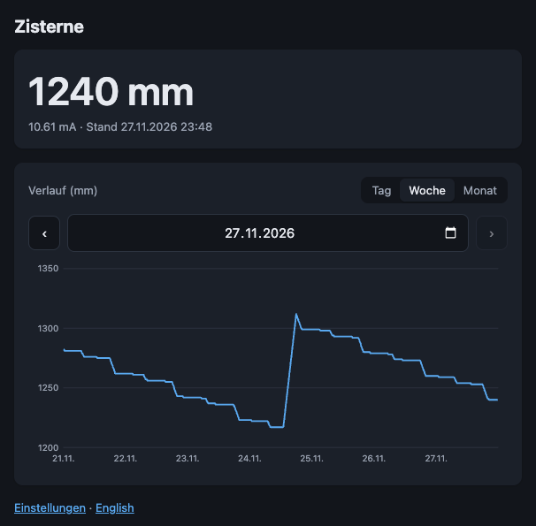

# Ersteinrichtung: Passwort, WLAN, MQTT, Kalibrierung

[English version](setup.md)

Nach dem ersten Einschalten (oder einem [Werksreset](#werksreset)) kennt die Zisterne
noch kein WLAN. Sie öffnet dann ein eigenes WLAN, über das du sie einrichtest.
Alles geht im Browser, am Handy oder am Laptop.

> Die Screenshots zeigen Beispielwerte (WLAN `MeinWLAN`, Füllstand 1240 mm).

## 1. Mit dem WLAN „Zisterne-Setup“ verbinden

1. Zisterne mit Strom versorgen. Die LED leuchtet die ersten 5 s (Zeitfenster für den
   Werksreset), danach dauerhaft: Das Gerät ist im **Access-Point-Modus**.
2. Am Handy oder Laptop mit dem WLAN **`Zisterne-Setup`** verbinden,
   Passwort **`zisterne`**.
3. Meldet das Handy „Kein Internet“, trotzdem verbunden bleiben.
4. Im Browser **`http://192.168.4.1/config`** öffnen.

## 2. Einstellungen öffnen und anmelden

Der Browser fragt nach Benutzer und Passwort. Ab Werk:

| Benutzer | Passwort |
|---|---|
| `zisterne` | `zisterne` |

Solange das Standardpasswort gilt, zeigt die Seite einen roten Hinweis und nur der
Reiter **Zugang** ist freigeschaltet. Auch OTA-Updates sind so lange gesperrt.

## 3. Eigenes Passwort setzen

1. Unter **Neues Passwort** ein eigenes Passwort eintragen. Den Benutzer kannst du bei
   Bedarf auch ändern.
2. **Speichern**.
3. Spätestens beim nächsten Aufruf fragt der Browser erneut nach dem Login: jetzt mit dem
   neuen Passwort anmelden.

Danach sind die Reiter **Verbindung** und **Kalibrierung** freigeschaltet. Dasselbe
Passwort gilt auch für OTA-Updates aus der Arduino IDE.

## 4. WLAN einstellen

1. Reiter **Verbindung**, Karte **WLAN**.
2. Beim Öffnen sucht die Zisterne im Hintergrund nach WLANs (der Knopf **Suchen** dreht
   dann kurz). Danach in das Feld **Netz** tippen: Die Liste zeigt die gefundenen Netze
   mit Signalstärke, das stärkste zuerst. **Suchen** startet eine neue Suche. Versteckte
   Netze kannst du auch von Hand eintippen.
3. **Passwort** des WLANs eintragen.
4. **Speichern**. Die Seite meldet „WLAN gespeichert, starte neu …“.

Die Zisterne startet neu und verbindet sich mit deinem WLAN, `Zisterne-Setup`
verschwindet. Handy oder Laptop wieder ins eigene WLAN wechseln und die Zisterne unter
**`http://zisterne.local/`** öffnen. Klappt `zisterne.local` nicht (manche
Android-Geräte), die IP-Adresse aus dem Router nehmen (Gerätename `Zisterne`).

Felder mit „unverändert“ bleiben leer, wenn du das gespeicherte Passwort behalten willst.

**Klappt die Verbindung nicht**, startet die Zisterne wieder `Zisterne-Setup`. Auf
`http://192.168.4.1/config` steht dann oben in Rot der Grund: WLAN nicht gefunden,
Passwort falsch oder keine Verbindung nach 20 s. War nur der Router aus, versucht sie
es alle 10 min von selbst erneut.

## 5. MQTT (optional)

MQTT schickt den Füllstand an einen Broker, z. B. an Home Assistant. Ein leeres Feld
**Broker** schaltet MQTT ab.

| Feld | Bedeutung |
|---|---|
| Broker / Port | Adresse des MQTT-Servers, Port meist `1883` (mit TLS `8883`) |
| TLS | `Aus`, `Verschlüsselt, ohne Serverprüfung` oder `Verschlüsselt, mit Serverprüfung` |
| CA-Zertifikat | nur für „mit Serverprüfung“: CA-Zertifikat des Brokers im PEM-Format |
| Benutzer / Passwort | Login am Broker |
| Topic | hierhin geht der Füllstand in mm (Standard `Wasserstand-Zisterne`) |
| Sendeintervall | wie oft der aktuelle Wert gesendet wird, 10–3600 s |
| Testwert | wird beim Speichern einmal gesendet, zum Testen ohne Sensor |

Home Assistant findet die Zisterne per MQTT-Discovery von selbst. Die ausführliche
Anleitung mit Broker-Einrichtung, TLS und Fehlersuche steht in
[Home-Assistant-Einbindung per MQTT](home-assistant-de.md).

## 6. Kalibrierung

Oben steht der **aktuelle Messwert**: der Sensorstrom und der daraus berechnete Füllstand.
Er wird beim Laden der Seite gemessen; zum Aktualisieren die Seite neu laden.

Der Sensor liefert 4 mA bei leerem Messbereich und 20 mA bei vollem. Daraus rechnet die
Zisterne:

> Füllstand = (Strom − 4 mA) / 16 mA × Messbereich + Offset

| Feld | Bedeutung |
|---|---|
| **Messbereich Sensor (mm)** | laut Datenblatt des Sensors, z. B. 0–3 m Wassersäule → `3000` |
| **Shunt (Ω)** | Messwiderstand auf der Platine, `75`. Nur ändern nach Tausch des Widerstands oder mit dem per Multimeter gemessenen Wert |
| **Offset (mm)** | wird zum Messwert addiert, z. B. wenn der Sensor ein paar Zentimeter über dem Boden hängt |
| **oder Ist-Füllstand jetzt (mm)** | der einfachere Weg zum Offset, siehe [Sensor kalibrieren](calibration-de.md) |
| **Messintervall (s)** | wie oft der Sensor gelesen wird, 10–300 s. Der Verlauf speichert unabhängig davon alle 5 min einen Wert |

So gleichst du den Sensor ab: [Sensor kalibrieren](calibration-de.md) (Schritt für Schritt, mit Skizze).

**Fehlermeldungen:**

- *Strom außerhalb 3,5–21 mA (Kabelbruch/Kurzschluss?)*: Sensor nicht angeschlossen,
  Kabel unterbrochen oder keine 24 V.
- *ADS1115 nicht gefunden*: Das Messmodul auf der Platine antwortet nicht. Sitz und
  Ausrichtung prüfen.

## 7. Fertig: die Startseite

`http://zisterne.local/` zeigt ohne Login den aktuellen Füllstand und den Verlauf als
Tag, Woche oder Monat. Mit den Pfeilen oder dem Datum blätterst du zurück; ein Tipp in die
Kurve zeigt den Wert zu diesem Zeitpunkt. Unten geht es zu den Einstellungen und zur
englischen Ansicht.

## Werksreset

Passwort vergessen oder Gerät umziehen: Strom aus, wieder an, und **innerhalb der ersten
5 s** (LED leuchtet) den Knopf **BOOT** am C3 mini **2 s gedrückt halten**. Danach sind
WLAN, Passwort, MQTT und Kalibrierung auf Werkseinstellung, die Einrichtung beginnt wieder
bei [Schritt 1](#1-mit-dem-wlan-zisterne-setup-verbinden). Der Verlauf bleibt erhalten.

## Fehlersuche

- **`Zisterne-Setup` taucht nicht auf**: Das Gerät hat noch ein funktionierendes WLAN
  gespeichert und ist dort verbunden. Im Router nachsehen oder Werksreset.
- **`192.168.4.1` lädt nicht**: Das Handy ist nicht mehr mit `Zisterne-Setup` verbunden
  (oft wegen „Kein Internet“). Mobile Daten kurz ausschalten.
- **Login klappt nicht**: Nach dem Passwortwechsel gilt das neue Passwort, auch für den
  Benutzer, falls geändert. Vergessen: Werksreset.
