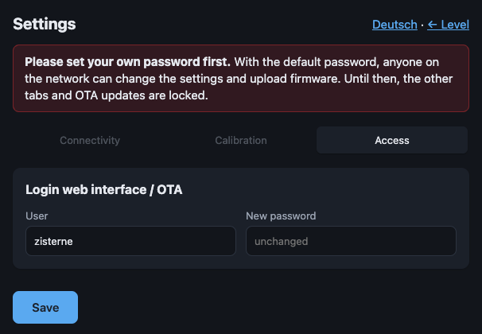
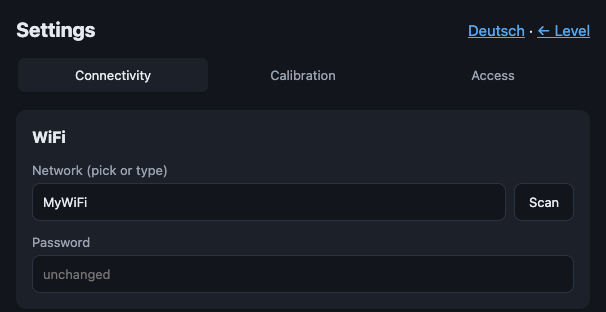
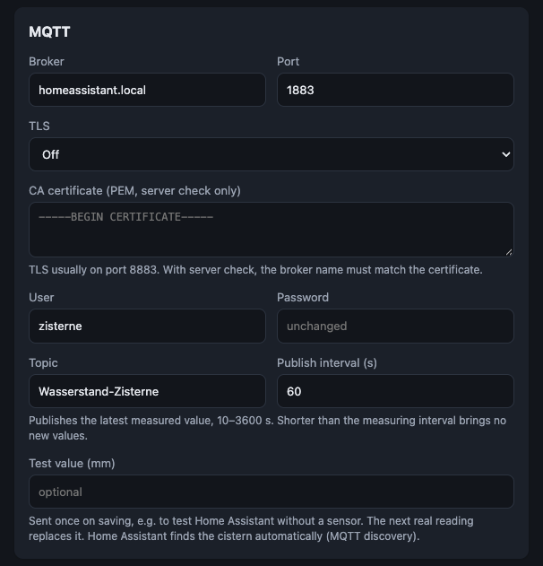
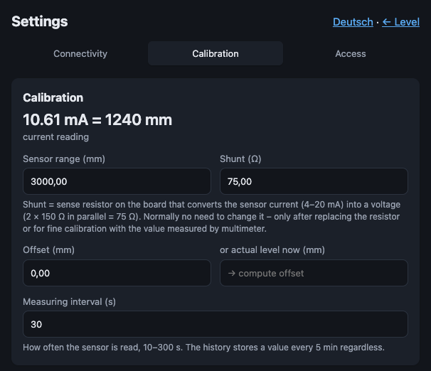
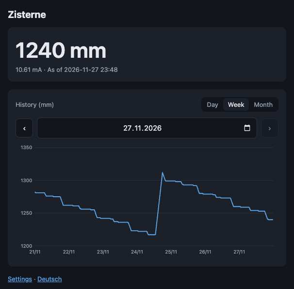

# First setup: password, WiFi, MQTT, calibration

[Deutsche Version](setup-de.md)

After the first power-up (or a [factory reset](#factory-reset)) the cistern doesn't know
any WiFi yet. It then opens its own WiFi network, which you use to set it up. Everything
happens in the browser, on a phone or a laptop.

> The screenshots show example values (WiFi `MyWiFi`, level 1240 mm).

## 1. Connect to the "Zisterne-Setup" WiFi

1. Power the cistern. The LED is on for the first 5 s (window for the factory reset),
   then it stays on: the device is in **access point mode**.
2. On your phone or laptop, connect to the WiFi **`Zisterne-Setup`**,
   password **`zisterne`**.
3. If the phone reports "no internet", stay connected anyway.
4. Open **`http://192.168.4.1/config`** in the browser.

## 2. Open the settings and log in

The browser asks for a user and password. Out of the box:

| User | Password |
|---|---|
| `zisterne` | `zisterne` |

As long as the default password is in use, the page shows a red notice and only the
**Access** tab is enabled. OTA updates are locked until then as well.

## 3. Set your own password

1. Enter your own password under **New password**. You can change the user too if you
   like.
2. **Save**.
3. On the next page load at the latest, the browser asks for the login again: log in with
   the new password.

The **Connectivity** and **Calibration** tabs are now enabled. The same password is also
used for OTA updates from the Arduino IDE.

## 4. Set up WiFi

1. **Connectivity** tab, **WiFi** card.
2. When the page opens, the cistern scans for WiFi networks in the background (the
   **Scan** button spins briefly). Then tap into the **Network** field: the list shows the
   networks found with their signal strength, strongest first. **Scan** starts a new scan.
   You can also type a hidden network by hand.
3. Enter the WiFi **Password**.
4. **Save**. The page reports "WiFi saved, restarting …".

The cistern restarts and connects to your WiFi, `Zisterne-Setup` disappears. Switch your
phone or laptop back to your own WiFi and open the cistern at
**`http://zisterne.local/`**. If `zisterne.local` doesn't work (some Android devices), use
the IP address from your router (device name `Zisterne`).

Leave fields showing "unchanged" empty to keep the stored password.

**If the connection fails**, the cistern starts `Zisterne-Setup` again. At
`http://192.168.4.1/config` the reason is then shown in red at the top: WiFi not found,
wrong password, or no connection after 20 s. If the router was just off, it retries on its
own every 10 min.

## 5. MQTT (optional)

MQTT sends the level to a broker, e.g. to Home Assistant. An empty **Broker** field turns
MQTT off.

| Field | Meaning |
|---|---|
| Broker / Port | address of the MQTT server, port usually `1883` (with TLS `8883`) |
| TLS | `Off`, `Encrypted, no server check` or `Encrypted, with server check` |
| CA certificate | only for "with server check": the broker's CA certificate in PEM format |
| User / Password | login at the broker |
| Topic | where the level in mm is published (default `Wasserstand-Zisterne`) |
| Publish interval | how often the current value is sent, 10–3600 s |
| Test value | sent once on saving, for testing without a sensor |

Home Assistant finds the cistern on its own via MQTT discovery. The detailed guide with
broker setup, TLS and troubleshooting is in
[Home Assistant integration via MQTT](home-assistant.md).

## 6. Calibration

At the top is the **current reading**: the sensor current and the level calculated from it.
It is measured when the page loads; reload the page to update it.

The sensor delivers 4 mA at the bottom of its range and 20 mA at the top. From this the
cistern calculates:

> level = (current − 4 mA) / 16 mA × range + offset

| Field | Meaning |
|---|---|
| **Sensor range (mm)** | from the sensor's data sheet, e.g. 0–3 m water column → `3000` |
| **Shunt (Ω)** | sense resistor on the board, `75`. Only change it after replacing the resistor or to enter the value measured by multimeter |
| **Offset (mm)** | added to the reading, e.g. when the sensor hangs a few centimetres above the bottom |
| **or actual level now (mm)** | the easier way to the offset, see below |
| **Measuring interval (s)** | how often the sensor is read, 10–300 s. The history stores a value every 5 min regardless |

**Offset from the actual level:** measure the water level in the cistern (e.g. with a
folding rule from the bottom to the water surface), enter it in **or actual level now** and
save. The cistern then measures right away and calculates the offset so that the display
matches exactly this value. On a sensor error the actual level is not applied, the other
fields are saved anyway.

Readings are smoothed (time constant 100 s) and fluctuations of ±1 mm are suppressed. When
the water level changes, the display therefore follows with a delay of a few minutes.

**Error messages:**

- *Current outside 3.5–21 mA (broken wire/short circuit?)*: sensor not connected, cable
  broken, or no 24 V.
- *ADS1115 not found*: the measuring module on the board doesn't respond. Check that it
  is seated correctly and the right way round.

## 7. Done: the start page

`http://zisterne.local/` shows the current level and the history by day, week or month,
without a login. Use the arrows or the date to go back; tapping the curve shows the value
at that time. At the bottom are links to the settings and to the German view.

## Factory reset

Forgot the password or moving the device: power off, power on, and **within the first
5 s** (LED on) **hold the BOOT button** on the C3 mini **for 2 s**. WiFi, password, MQTT and
calibration are then back to factory settings and setup starts again at
[step 1](#1-connect-to-the-zisterne-setup-wifi). The history is kept.

## Troubleshooting

- **`Zisterne-Setup` doesn't show up**: the device still has a working WiFi stored and is
  connected there. Check your router, or do a factory reset.
- **`192.168.4.1` doesn't load**: the phone is no longer connected to `Zisterne-Setup`
  (often because of "no internet"). Turn off mobile data for a moment.
- **Login fails**: after changing the password, the new password applies, and the new user
  if you changed it. Forgotten: factory reset.
